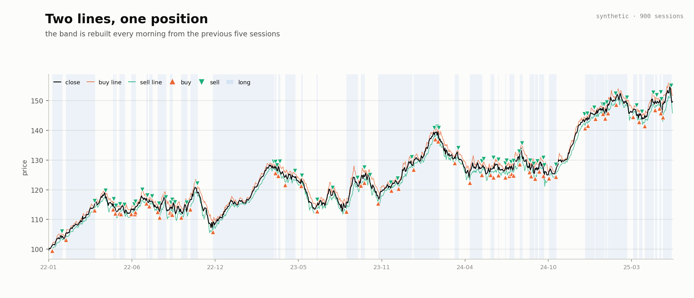
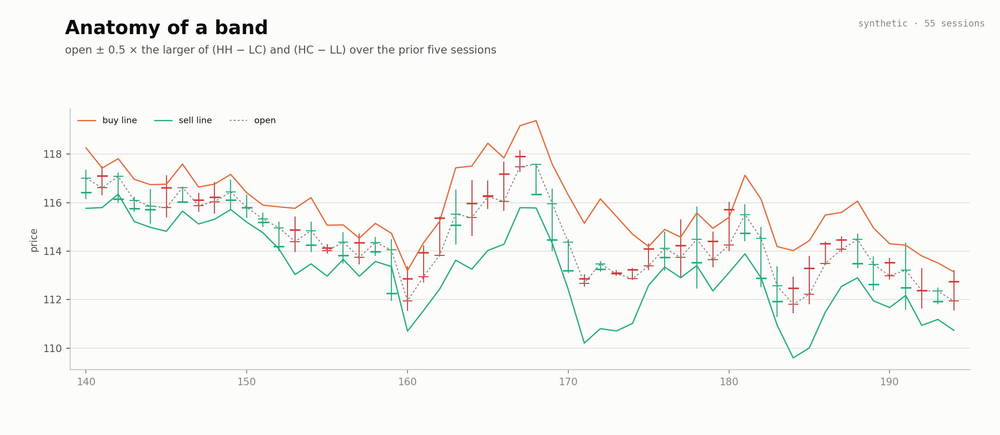
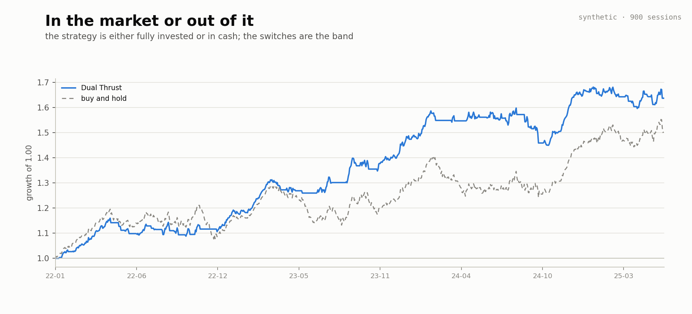
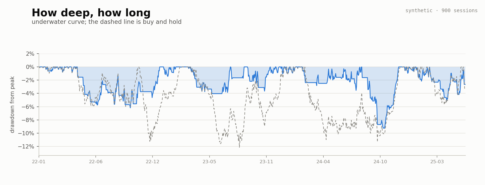

# Dual Thrust Signal

**A band around today's open, a long/flat switch, and two layers of stops —
packaged so the signal and the equity curve can be read without a notebook.**

Dual Thrust builds a channel from the last *n* sessions and trades the break:

```
HH = max(high)      LC = min(close)
HC = max(close)     LL = min(low)

range = max(HH − LC, HC − LL)
buy   = open + k1 × range
sell  = open − k2 × range
```

The band is set at the open from data that ends yesterday, so nothing in the
level uses today's bar. The position is either flat or fully invested.

[English](README.md) | [中文](README.zh-CN.md)



---

## The daily order

Each session, in this order:

| # | Rule | Effect |
|---|---|---|
| 1 | benchmark fell more than 3% today | go flat |
| 2 | stock fell 6% in two sessions, or 8% in three | go flat |
| 3 | today's low broke the sell line | go flat |
| 4 | today's high broke the buy line, and we are flat | buy |

Exits are checked before entries, and the three stop rules are checked in the
order above, so an index stop wins over a band exit on the same day.

Fills are at the **close** — a simplification the source module states
explicitly. A daily band is usually breached intraday, long before the close
prints; the engine keeps the same assumption so its curve matches the
notebook's.



---

## Quick start

```bash
pip install -r requirements.txt

# Offline: 900 synthetic sessions, the engine, four figures
python examples/demo_backtest.py

# Live, against baostock (free, no registration)
python -m src.dual_thrust.baostock_source run \
    --code sh.600519 --index sh.000300 --start 2022-01-01
```

As a library:

```python
from src.dual_thrust import Bar, Config, TradeConfig, backtest, metrics

result = backtest(stock_bars, index_bars, TradeConfig(signals=Config(n=5, k1=0.5, k2=0.5)))
stats = metrics(result, stock_bars)

stats.total_return, stats.max_drawdown, stats.trades
result.trades[:3]        # date, action, price, shares, note
```

---

## What the demo shows

```
sessions        900
total return    +63.72%
annualised      +14.80%
max drawdown    -9.28%
buys            68
win rate        44%
buy and hold    +50.31%
exits           SELL_DT=68
```

On this synthetic path the band exit does all the work: the stock never fell
6% in two sessions, and the index never fell 3% in one. The stop rules are
implemented and configurable, but they are not exercised here — the exit mix
printed above is the honest answer to "did anything else fire".





---

## Repository layout

```
.
├── src/dual_thrust/
│   ├── signals.py            # the band (pure)
│   ├── backtest.py           # state machine + metrics (pure)
│   └── baostock_source.py    # adapter + CLI
├── examples/
│   ├── demo_backtest.py      # synthetic market, four figures
│   └── figures/
├── legacy/dual_thrust_v1.py  # the original notebook cell, unmodified
├── notebooks/DualThrust 信号.ipynb
├── docs/算法总结.md
└── requirements.txt
```

---

## Scope

- **No validation claim.** The demo is a synthetic market with a fixed seed;
  the numbers above describe that path, not the strategy's edge. The original
  notebook ran a single stock (sh.600519) over 2022–2025.
- **Close fills, one position, no costs.** No slippage, no commission, no
  stamp duty, no position sizing. Fractional shares are used, so the equity
  curve is not achievable as written.
- **Forward-adjusted prices.** The band and the returns are on a rebased
  series; a live run on raw prices will differ around corporate actions.
- **One exit beats another.** When the index and the stock both trigger on the
  same day, only the first in the order above is recorded.

---

## Data & disclaimer

Market data from [baostock](http://baostock.com). For research and education
only — **not investment advice**.

## License

MIT
