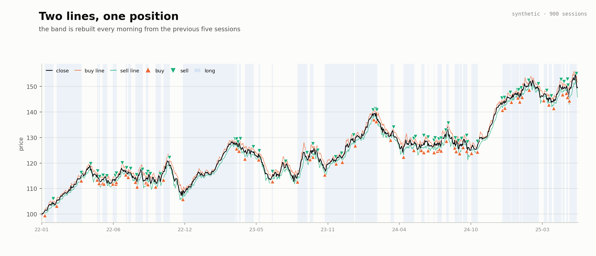
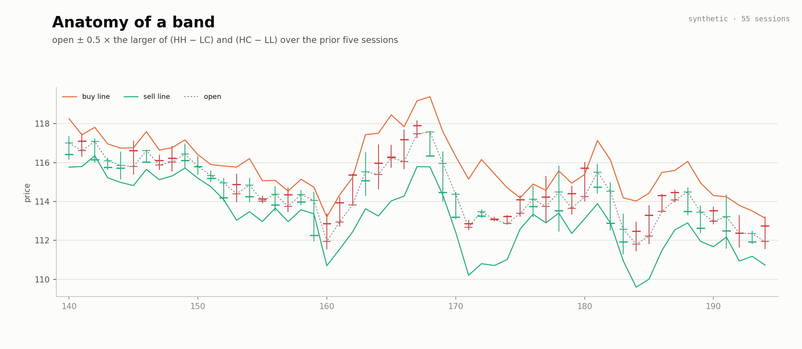
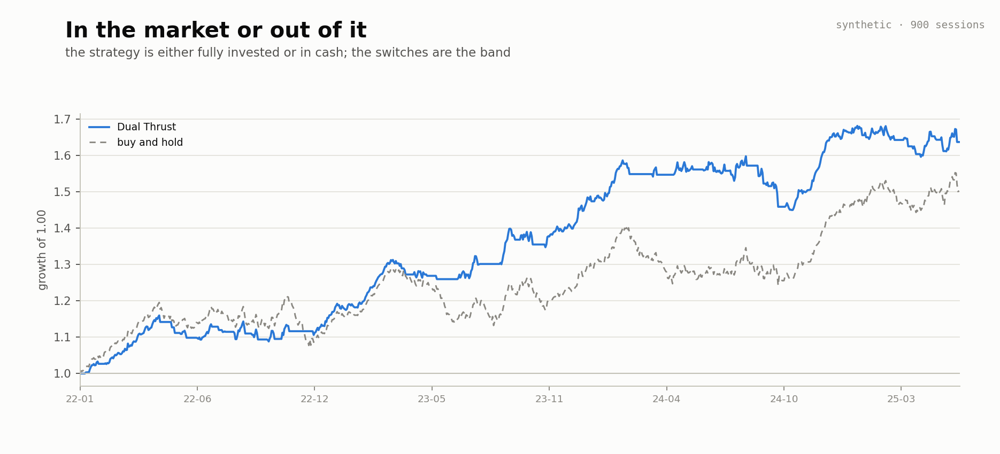
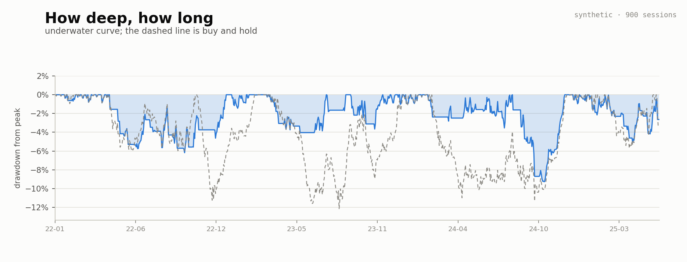

# Dual Thrust 信号

**以今日开盘价为中心的一条通道、一个满仓/空仓的开关，外加两层止损——把它打包成不用打开 notebook 也能读懂的形状。**

Dual Thrust 用最近 *n* 个交易日构造通道，突破就交易：

```
HH = 最高价的最高    LC = 收盘价的最低
HC = 收盘价的最高    LL = 最低价的最低

range = max(HH − LC, HC − LL)
买入线 = 今日开盘 + k1 × range
卖出线 = 今日开盘 − k2 × range
```

通道在开盘时就已经确定，用的是**昨天为止**的数据，当天的 K 线不参与计算。
持仓只有两种状态：空仓，或者满仓。

[English](README.md) | [中文](README.zh-CN.md)



---

## 每日的判定顺序

| # | 规则 | 动作 |
|---|---|---|
| 1 | 大盘当日跌幅超过 3% | 清仓 |
| 2 | 个股两日跌 6%，或三日跌 8% | 清仓 |
| 3 | 当日最低价跌破卖出线 | 清仓 |
| 4 | 当日最高价突破买入线，且当前空仓 | 买入 |

先判卖出、再判买入；三条止损按上表顺序检查，所以同一天里大盘止损优先于通道卖出。

成交价统一用**收盘价**——这是原始模块自己声明的简化处理。
日线级别的通道通常在盘中就被击穿，远早于收盘；引擎保留同样的假设，
以便和 notebook 的结果对齐。



---

## 快速开始

```bash
pip install -r requirements.txt

# 离线：900 个合成交易日，完整引擎，四张图
python examples/demo_backtest.py

# 联网（baostock，免费、无需注册）
python -m src.dual_thrust.baostock_source run \
    --code sh.600519 --index sh.000300 --start 2022-01-01
```

当成纯库用：

```python
from src.dual_thrust import Bar, Config, TradeConfig, backtest, metrics

result = backtest(stock_bars, index_bars, TradeConfig(signals=Config(n=5, k1=0.5, k2=0.5)))
stats = metrics(result, stock_bars)

stats.total_return, stats.max_drawdown, stats.trades
result.trades[:3]        # 日期、动作、价格、股数、备注
```

---

## 离线 demo 的输出

```
sessions        900
total return    +63.72%
annualised      +14.80%
max drawdown    -9.28%
buys            68
win rate        44%
buy and hold    +50.31%
exits           SELL_DT=68
```

在这条合成路径上，所有出场都由通道卖出完成：个股从未两日跌 6%，大盘也从未单日跌 3%。
止损规则实现了、也可配置，但这组数据没触发它们——上面打印的出场构成就是诚实的答案。





---

## 目录结构

```
.
├── src/dual_thrust/
│   ├── signals.py            # 通道计算（纯函数）
│   ├── backtest.py           # 状态机 + 绩效（纯函数）
│   └── baostock_source.py    # 适配层 + CLI
├── examples/
│   ├── demo_backtest.py      # 合成市场，四张图
│   └── figures/
├── legacy/dual_thrust_v1.py  # 原始 notebook cell，未改动
├── notebooks/DualThrust 信号.ipynb
├── docs/算法总结.md
└── requirements.txt
```

---

## 范围说明

- **不做有效性背书。** demo 是固定种子的合成市场，上面的数字只描述那条路径；
  原 notebook 跑的是单只股票（sh.600519）2022–2025。
- **收盘价成交、单一仓位、不算成本。** 没有滑点、佣金、印花税、仓位管理；
  而且用了小数股，净值曲线按原样是买不出来的。
- **前复权价格。** 通道和收益都建立在复权序列上，除权附近用原始价格跑会有差异。
- **一次只记一笔出场。** 同一天里多个条件同时触发，只记录顺序最靠前的那一条。

---

## 数据与声明

行情来自 [baostock](http://baostock.com)。仅供研究与学习，**不构成投资建议**。

## 许可证

MIT
